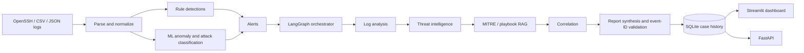

# Agentic AI Cybersecurity Analyst

An AI-assisted Security Operations Center (SOC) analysis project. It ingests authentication logs, detects suspicious patterns, enriches indicators, retrieves cybersecurity guidance, and produces case reports through a multi-agent workflow.

> This is a local research/demo application, not an autonomous production security control. Review findings before taking action.

## Problem

Security analysts often need to correlate authentication events, detection alerts, threat intelligence, and incident-response guidance manually. This project demonstrates how deterministic detection, machine learning, retrieval-augmented generation (RAG), and language-model agents can assist with that investigation workflow.

## Objectives

- Parse and normalize OpenSSH, CSV, and JSON authentication logs.
- Detect suspicious authentication behavior using rules and optional ML.
- Coordinate specialized analysis steps with LangGraph.
- Ground knowledge retrieval in the bundled MITRE ATT&CK subset and incident-response playbooks.
- Generate structured reports and persist reviewed cases locally.
- Offer both a Streamlit dashboard and a FastAPI interface.

## Architecture



The investigation graph contains an orchestrator, log-analysis node, threat-intelligence node, knowledge node, correlation node, and report node. The report agent validates cited event IDs against the supplied events. Ollama is used when available; the project also provides a deterministic mock LLM for offline/testing use.

## Implemented capabilities

- **Ingestion:** OpenSSH syslog, CSV, and JSON parsers; field normalization; deterministic event IDs.
- **Detection:** authentication rules for brute-force, failed-then-success, and user-enumeration patterns; optional ML alerts.
- **Machine learning:** Isolation Forest anomaly scoring and Random Forest attack classification, using 13 engineered session features. Models load from the local cache or train from the bundled synthetic baseline data.
- **Multi-agent analysis:** sequential LangGraph workflow with streamed node progress, investigation context, and report synthesis.
- **RAG:** sentence-transformer embeddings and FAISS semantic retrieval over the included ATT&CK subset and incident-response playbooks. The index is built locally from the source JSON files when it is not cached.
- **Threat intelligence:** mock provider by default, with optional AbuseIPDB or VirusTotal lookups. Private, loopback, and link-local addresses are filtered from external lookup.
- **Case management:** SQLAlchemy/SQLite persistence, case history, analyst notes, and review states (`PENDING`, `APPROVED`, `ESCALATED`, `FALSE_POSITIVE`).
- **User interfaces:** five-tab Streamlit dashboard and FastAPI REST endpoints.
- **Evaluation:** pytest suite and a scenario-based benchmark command.

## Technologies

Python, Streamlit, FastAPI, Pydantic, LangGraph, Ollama, sentence-transformers, FAISS, scikit-learn, SQLAlchemy, SQLite, and pytest.

## Repository structure

```text
.
├── agents/              # Investigation agent nodes and LLM clients
├── api/                 # FastAPI routes and request/response models
├── config/              # Environment-backed settings
├── data/
│   ├── knowledge/       # ATT&CK subset and incident-response playbooks
│   ├── samples/         # Synthetic/sample authentication logs and datasets
│   └── test_cases/      # Evaluation scenarios
├── detection/           # Deterministic detection rules
├── evaluation/          # Benchmark runner
├── graph/               # Shared state and LangGraph workflow
├── ingestion/           # Parsers and event normalization
├── ml/                  # Feature engineering, dataset, and detector
├── models/              # Pydantic schemas
├── rag/                 # Embeddings, index building, and retrieval
├── reports/             # Markdown report rendering
├── storage/             # SQLite database manager and ORM models
├── tests/               # Unit and integration tests
├── tools/               # Threat-intelligence providers
├── .env.example         # Configuration template (no credentials)
├── DEFENSE_GUIDE.md     # Security design notes
├── app.py               # Streamlit dashboard
├── requirements.txt     # Python dependencies
└── pytest.ini           # pytest configuration
```

Local environments (`.venv`), credentials (`.env`), SQLite databases, trained model files, and generated RAG cache files are excluded from Git. The RAG index and ML models can be recreated locally from the included source data.

## Windows setup

### 1. Clone and install

Install Python 3.11, then open PowerShell:

```powershell
git clone https://github.com/Talarisaijoshwika6666/Agentic_AI.git
cd Agentic_AI
py -3.11 -m venv .venv
.\.venv\Scripts\Activate.ps1
python -m pip install --upgrade pip
pip install -r requirements.txt
Copy-Item .env.example .env
```

If PowerShell blocks environment activation, either use a new Command Prompt and run `.venv\Scripts\activate.bat`, or allow scripts only for the current PowerShell process with `Set-ExecutionPolicy -Scope Process -ExecutionPolicy Bypass`.

### 2. Configure environment

Edit `.env` as needed. Keep this file local; it is ignored by Git. `.env.example` contains placeholders and is safe to commit.

| Setting | Purpose |
| --- | --- |
| `OLLAMA_BASE_URL` | Ollama server URL; defaults to `http://localhost:11434`. |
| `OLLAMA_MODEL` | Local model name; defaults to `qwen3:4b`. |
| `USE_MOCK_LLM` | Set to `true` to use the deterministic mock client. |
| `ABUSEIPDB_API_KEY` | Optional AbuseIPDB key. |
| `VIRUSTOTAL_API_KEY` | Optional VirusTotal key. |
| `DATABASE_URL` | SQLite URL; defaults to a local database under `data/`. |
| `ML_ANOMALY_CONTAMINATION`, `ML_ANOMALY_SCORE_THRESHOLD` | Optional ML tuning values. |
| `BRUTE_FORCE_THRESHOLD`, `BRUTE_FORCE_WINDOW_MINUTES`, `FAILED_THEN_SUCCESS_WINDOW_MINUTES`, `USER_ENUMERATION_THRESHOLD` | Optional rule thresholds. |

Threat-intelligence API keys are optional. Without a configured provider key, the threat-intelligence service uses its mock provider. If Ollama is unavailable, the LLM client falls back to the mock client.

### 3. Install and start Ollama (optional)

Install Ollama for Windows from [ollama.com](https://ollama.com/), start the Ollama application, and pull the configured model:

```powershell
ollama pull qwen3:4b
ollama list
```

The first RAG run may download the configured sentence-transformer model. It also builds the local FAISS index from `data/knowledge/`.

## Run the application

### Streamlit dashboard

From the project directory with the virtual environment activated:

```powershell
streamlit run app.py
```

Open `http://localhost:8501`. The dashboard includes:

1. Ingestion and normalized telemetry
2. Detection alerts
3. Multi-agent investigation and report
4. Knowledge-base search and indicator lookup
5. SQLite case management and analyst review

To try the bundled OpenSSH sample, use the dashboard's **OpenSSH Log** sample control or upload `data/samples/openssh_sample.log`.

### FastAPI backend

```powershell
python -m uvicorn api.routes:app --host 127.0.0.1 --port 8000 --reload
```

Open `http://127.0.0.1:8000/docs` for interactive API documentation.

Available routes:

| Method | Route | Purpose |
| --- | --- | --- |
| `GET` | `/api/v1/health` | Health and runtime information |
| `POST` | `/api/v1/investigate` | Parse logs, detect alerts, and run an investigation |
| `GET` | `/api/v1/cases` | List cases with optional filters |
| `GET` | `/api/v1/cases/{case_id}` | Retrieve a case |
| `PATCH` | `/api/v1/cases/{case_id}/status` | Update review status and notes |
| `DELETE` | `/api/v1/cases/{case_id}` | Delete a case |
| `POST` | `/api/v1/indicators/lookup` | Look up an IP indicator |
| `POST` | `/api/v1/knowledge/search` | Search the RAG knowledge base |

The API currently has no authentication and permissive CORS configuration. Keep it bound to localhost unless you add appropriate access controls and deployment hardening.

### Sample API investigation

Start the API, then submit the included sample log from PowerShell:

```powershell
$log = Get-Content .\data\samples\openssh_sample.log -Raw
$body = @{
    log_content = $log
    log_format = "auth_openssh"
    enable_ml = $true
} | ConvertTo-Json

Invoke-RestMethod `
    -Uri "http://127.0.0.1:8000/api/v1/investigate" `
    -Method Post `
    -ContentType "application/json" `
    -Body $body
```

The bundled sample contains authentication failures and successful-login examples for demonstration; it is not a substitute for validating detection against your own authorized test data.

## Multi-agent workflow

1. The orchestrator selects and prioritizes an alert.
2. The log agent summarizes events and behavioral patterns.
3. The threat-intelligence node enriches IP indicators when configured.
4. The knowledge agent retrieves relevant ATT&CK/playbook excerpts.
5. The correlation agent combines findings into a timeline and technique mappings.
6. The report agent generates a structured report and validates its event IDs.

## RAG and machine learning

The RAG knowledge source files are in `data/knowledge/`. The vector index is generated under the ignored `data/cache/` directory when needed. The ML detector derives behavioral features from normalized events and trains or loads its local models from the ignored cache. These generated artifacts are intentionally not required in the repository.

## Tests and benchmark

Run the test suite:

```powershell
python -m pytest -q
```

Run the scenario benchmark:

```powershell
python -m evaluation.benchmark
```

## Screenshots

No application screenshots are currently committed. Add screenshots of the running dashboard here when available; avoid including real log data, credentials, or personally identifiable information.

## Security and privacy

- Use only logs you are authorized to analyze; prefer the bundled synthetic samples for demonstrations.
- Never commit `.env`, API keys, access tokens, private logs, or local case databases.
- External threat-intelligence providers may receive public IP indicators when enabled. Private, loopback, and link-local addresses are filtered by the current lookup service.
- Generated local databases, model files, and RAG caches are ignored by Git.
- The project provides analyst recommendations; it does not automatically execute containment actions.

See [DEFENSE_GUIDE.md](DEFENSE_GUIDE.md) for additional implementation notes.

## Planned enhancements

The following are not implemented yet:

- Add screenshots from the current dashboard.
- Add authentication and role-based access before any network-facing API deployment.
- Expand supported log sources and provider integrations.
- Add automated CI checks for tests and documentation.

## License

No `LICENSE` file is currently included. Add a license file after choosing the terms under which this project may be used and redistributed.
